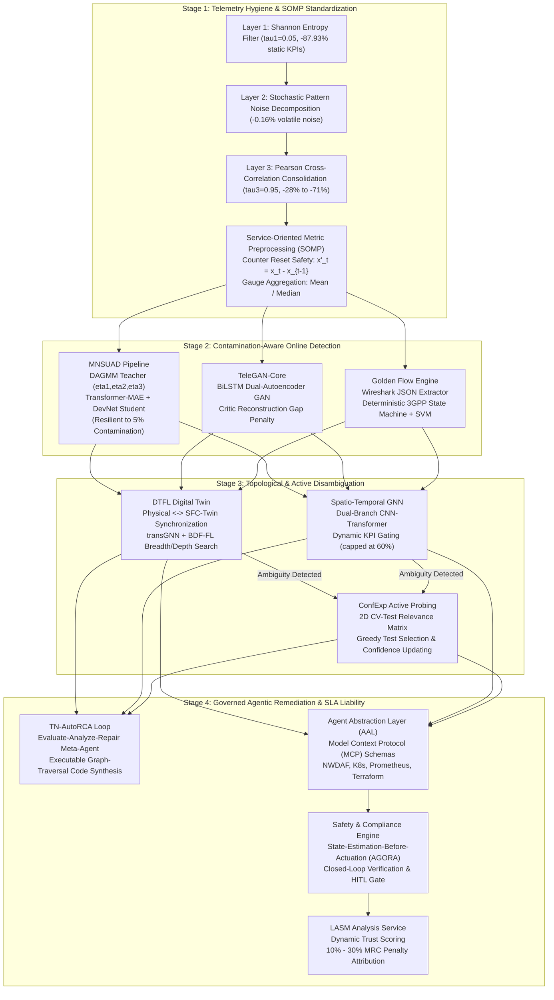
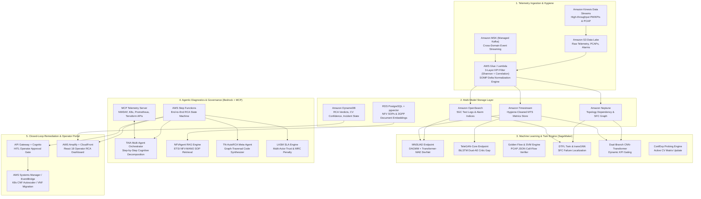

# Project Requirement Document (PRD)

## Intelligent Root Cause Analysis (RCA) Framework for Telecom Cloud Services

| Field              | Value                                                      |
| ------------------ | ---------------------------------------------------------- |
| **Version**        | 2.0 (Aligned with Telecom Cloud RCA Research Report 2026)  |
| **Date**           | 2026-10-15                                                 |
| **Status**         | Approved / Architecture Baseline                           |
| **Classification** | Carrier-Grade Academic & Industrial Reference Framework    |

---

## 1. Executive Summary

This document specifies the requirements for an **Intelligent Root Cause Analysis (RCA) Framework** designed for modern **Telecom Cloud Services**. As telecommunication networks evolve from monolithic Physical Network Functions (PNFs) to Virtual Network Functions (VNFs) and Cloud-Native Network Functions (CNFs) orchestrated via Kubernetes within 5G Service-Based Architectures (SBA) and emerging 6G systems, diagnostic complexity scales exponentially. A single hypervisor degradation, HTTP/2 signaling failure, or residual CI/CD misconfiguration cascades across horizontal service meshes and vertical virtualization layers, generating massive alarm storms.

Grounding its design in **15 peer-reviewed research papers (2023–2026)**, this framework combines:
1. **Telemetry Hygiene & Service-Oriented Metric Preprocessing (SOMP)**: Dynamic 3-layer KPI filtering (Shannon entropy, stochastic noise decomposition, Pearson cross-correlation) achieving ~90% dimensionality reduction.
2. **Contamination-Resilient & Dual-Autoencoder Anomaly Detection**: Weakly-supervised Masked Autoencoders with Deviation Networks (MNSUAD) handling up to 5% unlabeled training data contamination, alongside BiLSTM Dual-Autoencoder GANs (TeleGAN-Core) with critic reconstruction gap penalties.
3. **Topological Graph Learning & Digital Twins**: Digital Twin-assisted Graph Neural Networks (DTFL) with synthetic fault injection, Spatio-Temporal Attention GNNs, and Dual-Branch CNN-Transformers with dynamic KPI gating.
4. **Deterministic Call-Flow Verification & Active Diagnostic Probing**: Wireshark JSON Golden Flow protocol state machines and ConfExp active diagnostic test selection across Configuration Variables (CVs).
5. **Governed Agentic AI & Model Context Protocol (MCP)**: Self-improving code-synthesis loops (TN-AutoRCA on the TN-RCA530 benchmark), multi-agent orchestration (TAIA, NFVAgent) over standardized MCP interfaces, and multi-actor SLA liability attribution (LASM).

The system is deployed on **AWS Cloud** and evaluated against both the **RCAEval benchmark dataset** (735 microservice failure cases) and the **TN-RCA530 operational telecom benchmark** (530 telecom base station cases, 94.5% Difficult), alongside production Vodafone NFV and ENCQOR 5G datasets.

---

## 2. Problem Statement and Structural Bottlenecks

Modern telecom cloud infrastructure exhibits three structural bottlenecks that defeat legacy Operations Support Systems (OSS) and static threshold alarms:

1. **High-Dimensional Telemetry and Non-Stationary Drift**:
   A single commercial 5G Core deployment exports tens of thousands of heterogeneous Performance Management (PM) counters, gauges, and Key Performance Indicators (KPIs). Their baseline statistical signatures shift abruptly following CI/CD software updates or traffic rerouting, inducing severe alert fatigue.
2. **Training Data Contamination and Label Scarcity**:
   Historical operational repositories from multi-datacenter NFV infrastructures inevitably contain up to 5% unlabeled anomalous contamination alongside extreme class imbalance for rare catastrophic failure modes. Conventional unsupervised models overfit to this contamination, degrading localization precision.
3. **Opaque Black-Box Inference and Agentic Hallucination Risks**:
   Deploying unverified neural networks or probabilistic Large Language Models (LLMs) directly into live carrier control planes risks misattribution or catastrophic misconfiguration. Without mathematical explainability (XAI), standardized tool contracts (Model Context Protocol), and strict state-estimation-before-actuation compliance, autonomous agents cannot meet carrier-grade safety standards.

---

## 3. Project Objectives

| ID | Objective | Success Criterion | Research Grounding |
|---|---|---|---|
| **OBJ-1** | **Telemetry Hygiene & Preprocessing** | Achieve 88%–91% KPI dimensionality reduction via 3-layer filtering (Shannon entropy $\tau_1=0.05$, stochastic decomposition, Pearson correlation $\tau_3=0.95$) with counter reset safety ($x_t'=x_t-x_{t-1}$). | IEEE ISCC 2025; TeleGAN-Core (Paper 4) |
| **OBJ-2** | **Contamination-Resilient Detection** | Maintain $\ge 85\%$ F1-score in VNF anomaly detection and fault localization under 5.0% unlabeled training data contamination. | MNSUAD (Paper 1) |
| **OBJ-3** | **Deterministic Signaling Verification** | Achieve 100% fault detection on 5G Core PCAP call flows (Registration, PDU Session Establishment, Deregistration) isolating exact faulty frames. | Golden Flow + SVM (Paper 11) |
| **OBJ-4** | **Topological SFC Failure Localization** | Outperform non-Digital Twin baselines by $\ge 12\%$ accuracy on Service Function Chains using transGNN and Breadth/Depth-First search (BDF-FL). | DTFL (Paper 2) |
| **OBJ-5** | **Self-Improving Alarm RCA** | Elevate LLM alarm RCA F1-score from $\sim 59\%$ baseline to $\ge 90\%$ on the TN-RCA530 benchmark (530 real telecom cases, 94.5% Difficult) via iterative code synthesis. | TN-AutoRCA (Paper 7) |
| **OBJ-6** | **Hallucination-Free Agentic Tool Calling** | Achieve 100% entity extraction with $<0.9\%$ latency overhead using Model Context Protocol (MCP) schemas over NWDAF, K8s, and Prometheus. | MCP-Diag & NIKA (Paper 14); TAIA (Paper 5) |
| **OBJ-7** | **Multi-Actor SLA Liability Attribution** | Accurately compute dynamic trust scores and attribute 10%–30% Monthly Recurring Charge (MRC) penalty gradations across multi-tenant microservices. | LASM Analysis Service (Paper 3) |
| **OBJ-8** | **Sub-20s Self-Healing & MTTR Reduction** | Trigger automated VNF scaling/migration in $<18$ seconds, achieving $\ge 70\%$ reduction in Mean Time to Repair (MTTR). | IJSEA 2025; AGORA 2025 |

---

## 4. Literature Foundation (15 Verifiable Papers, 2023–2026)

The framework is grounded in 15 peer-reviewed and preprint academic papers defining the state of the art in telecom cloud RCA:

### 4.1 Research Synthesis Table

| Paper # | Authors & Year | Venue | Telecom Cloud Domain | Core Algorithmic & Architectural Mechanism | Key Empirical Finding / Metric |
|---|---|---|---|---|---|
| **1** | Johari et al. (2025) | IEEE Trans. Mobile Comput. (TMC) | Multi-Datacenter NFV / VNF Infrastructure | **MNSUAD**: DAGMM teacher pseudo-labeling ($\eta_1,\eta_2,\eta_3$) + Transformer Masked Autoencoder (MAE) & DevNet student; XAI via Mask/Cluster Permutation & SHAP. | Up to +20% F1 anomaly detection & +22% F1 fault localization under 5% data contamination across Vodafone 11-country NFV. |
| **2** | Guo et al. (2023) | IEEE Trans. Cloud Comput. (TCC) | NFV Service Function Chains (SFC) | **DTFL**: 3-layer Digital Twin (Physical, SFC-Twin, Service) with fault injection, BERT embeddings, transGNN, and BDF-FL breadth/depth search. | ~13% higher RCA accuracy over non-Digital Twin baselines; mitigates extreme class imbalance. |
| **3** | Anser et al. (2025) | IEEE Trans. Netw. Serv. Manage. (TNSM) | 5G/6G Cloud-to-Edge Dynamic Microservices | **LASM Analysis Service (LAS)**: ML-driven root cause, dynamic trust scoring, and contractual SLA liability attribution (INSPIRE-5Gplus). | Isolates culpable microservice providers; adjudicates 10%–30% Monthly Recurring Charge (MRC) penalties. |
| **4** | Issa et al. (2026) | IEEE Access | Cloud-Native 5G Core (5GC) SBA | **TeleGAN-Core**: 3-lane pipeline with Service-Oriented Metric Preprocessing (SOMP) and BiLSTM Dual-Autoencoder GAN with critic reconstruction gap penalty. | Eliminates alert fatigue on ENCQOR 5G dataset; attributes anomalies directly to 5GC NFs and PM counters. |
| **5** | Panek et al. (2025) | IEEE ICC Workshops | Cloud-Native 5G & Kubernetes CNFs | **TAIA**: Modular multi-agent AI assistant; step-by-step logical decomposition, ontology grounding, Prometheus closed-loop state verification, and Human-in-the-Loop (HITL). | Prevents LLM hallucinations; safely translates operator intents into Kubernetes, Prometheus, and Terraform actions. |
| **6** | Woo & Woo (2025) | IEEE/IFIP CNSM | Heterogeneous NFV & 5GC Systems | **NFVAgent**: Retrieval-Augmented Generation (RAG) LLM agent integrated with ETSI NFV-MANO for automated root-cause diagnosis and resilient failure recovery. | Grounds recovery workflows in historical NFV operational corpora without expensive fine-tuning. |
| **7** | Wu et al. (2025/2026) | ICLR 2026 (arXiv:2507.18190) | 5G Base Stations (BBU/RRU) & NFV | **TN-AutoRCA & TN-RCA530**: 530-case operational benchmark (94.5% Difficult) + agentic evaluate-analyze-repair loop synthesizing executable graph-traversal code. | Boosts Gemini-2.5-Pro RCA F1 from 58.99% baseline to 91.79% via iterative contrastive code repair. |
| **8** | Enz et al. (2024) | IEEE ICC Workshops | Telco Cloud-to-Edge Microservices Continuum | **MALEAF**: Machine learning-driven anomaly detection, root cause localization, and multi-class fault classification (CPU, memory, packet loss). | Accurately localizes culprit containers and classifies multi-class fault types across dynamic edge-cloud topologies. |
| **9** | Heeb et al. (2023) | ACM SAC | IoT-Extended 5G Microservice Environments | **IoMiRCA**: Cross-tier dependency and telemetry correlation framework across IoT-extended edge gateways and 5G core microservices. | Disambiguates whether fault propagation originated in edge IoT nodes or cloud-native 5G core microservices. |
| **10** | Wang et al. (2025/2026) | IEEE CRESS | Cloud-Native 5G Core Networks | **Two-Stage Multi-Source RCA**: Coarse anomaly screening (Stage 1) + cross-modal correlation fusing NF text logs, packet traffic, and container metrics (Stage 2). | Overcomes single-modality blind spots for complex control-plane signaling anomalies in 5GC O&M. |
| **11** | Isaac et al. / Jarrah et al. (2024/2025) | IEEE ICC Wksps & arXiv | 5G Core Signaling & Call Flows (PCAP) | **Golden Flow + Protocol-Grouped SVM + GenAI**: Wireshark JSON parsing, deterministic 3GPP call-flow state verification, protocol-grouped SVM, domain-tuned LLM. | 100% fault detection accuracy on 5GC Registration, PDU Session, Deregistration; pinpoints exact frame (e.g. Frame 23 Congestion). |
| **12** | Koushki et al. (2025) | J. Netw. Syst. Manage. (JNSM) | Enterprise & Telecom SOA / Microservices | **ConfExp**: Active diagnostic probing over SEED emulator using 2D Configuration Variable (CV) relevance matrix and dynamic confidence updating. | Deterministically isolates root-cause misconfigurations across DNS, DHCP, routing, and firewall rules. |
| **13** | Wang et al. (2024) | IEEE OJ-COMS | 5G/6G SDN, NFV, MEC, Zero-Touch Networks | **XAI for 6G Diagnostics**: SHAP, LIME, Layer-wise Relevance Propagation (LRP), surrogate trees, and counterfactual explanations in 5G/6G control loops. | Dual diagnostic mandate: diagnoses physical/virtual service faults AND faulty decisions made by black-box AI control loops. |
| **14** | Chen, Wang, Yin et al. (2025/2026) | Int. J. Netw. Manage. (IJNM) | Cross-Domain 5G/6G (RAN, TN, NWDAF, K8s) | **MCP-Diag & NIKA ReAct Agents**: Two-step LangGraph ReAct agents using Model Context Protocol (MCP) over NWDAF, Transport INT, and Prometheus. | MCP-Diag achieves 100% entity extraction with <0.9% latency overhead; virtually eliminates tool hallucinations across 150 incidents. |
| **15** | Frontiers in AI (2025) & MDPI Appl. Sci. (2026) | Front. Artif. Intell. & Appl. Sci. | Cloud-Native Microservices & 5G KPI Time Series | **Spatio-Temporal Attention GNN & Dual-Branch CNN-Transformer**: Invocation graph attention + 1D-CNN local branch + 2-head Transformer with learnable positional embeddings. | Captures indirect multi-hop fault propagation and non-uniform temporal 5G fault onset-to-recovery dynamics with dynamic KPI gating. |

---

## 5. Architectural Blueprint

### 5.1 Four-Stage Reference Pipeline for Carrier-Grade Deployment

Following Table 5 of the Research Report, the operational pipeline executes across four distinct stages:

### 5.2 AWS Cloud Implementation Architecture

---

## 6. Dataset Specification

### 6.1 Benchmark Suites

The framework is validated across four complementary academic and production datasets:

1. **TN-RCA530 Benchmark (Paper 7 - ICLR 2026)**:
   - **Scale**: 530 real-world operational scenarios grounded in telecom base station topologies (BBUs, RRUs, physical/logical links).
   - **Complexity**: 94.5% classified as "Difficult" featuring long-tail root causes and multi-hop overlapping alarm storms; validated via backward-forward cycle consistency.
   - **Target**: Evaluates graph-traversal code synthesis and self-improving agentic loops.
2. **RCAEval Benchmark (WWW 2025 - arXiv:2412.17015)**:
   - **Scale**: 735 labelled failure cases across 3 diverse microservice topologies.
   - **Modalities**: Synchronized multivariate metrics, unstructured logs, and distributed traces with exact `root_cause_service` ground truth.
   - **Target**: Evaluates cross-modal ranking, Top-K accuracy, MRR, and MAP@K.
3. **Vodafone NFV Production Dataset (Paper 1 - IEEE TMC 2025 / IEEE CLOUD 2025)**:
   - **Scale**: Real production telemetry from multi-datacenter NFV infrastructure spanning 11 European countries.
   - **Condition**: Up to 5% unlabeled anomalous contamination in historical baselines.
   - **Target**: Evaluates MNSUAD weakly-supervised anomaly detection and XAI localization.
4. **ENCQOR 5G Testbed Dataset (Paper 4 - IEEE Access 2026)**:
   - **Scale**: Commercial cloud-native 5G Core Service-Based Architecture telemetry (AMF, SMF, UPF, NRF).
   - **Target**: Evaluates Service-Oriented Metric Preprocessing (SOMP) and TeleGAN-Core BiLSTM Dual-Autoencoder GAN.

---

## 7. Functional Requirements

### 7.1 Layer 1 & 2: Telemetry Hygiene, Ingestion, & Normalization

| ID | Functional Requirement | Priority | Mapped Papers |
|---|---|---|---|
| **FR-1.1** | **Three-Layer Daily KPI Filter**: Deploy automated Shannon entropy screening ($\tau_1=0.05$), stochastic time-series decomposition noise elimination, and Pearson cross-correlation consolidation ($\tau_3=0.95$), achieving $\ge 88\%$ global dimensionality reduction. | Must | IEEE ISCC 2025 |
| **FR-1.2** | **Service-Oriented Metric Preprocessing (SOMP)**: Guarantee counter reset safety by converting cumulative counters into interval delta increments ($x_t' = x_t - x_{t-1}$) and aggregating gauges via mean or median. | Must | Paper 4 (TeleGAN-Core) |
| **FR-1.3** | **PCAP Call-Flow Extraction**: Ingest 5G Core SBI packet capture traces via Wireshark JSON extraction for Registration, PDU Session Establishment, and Deregistration call flows. | Must | Paper 11 (Golden Flow) |
| **FR-1.4** | **Unified Multi-Modal Event Bus**: Stream normalized metric, log, trace, alarm, and signaling events via Amazon MSK/Kinesis into Timestream, OpenSearch, and Neptune. | Must | Papers 1, 10, 14 |
| **FR-1.5** | **Privacy & Tenant Fencing**: Enforce Data Usage Control (DUC) policies to fence private 5G NPN telemetry from public PLMN data lakes. | Should | PEDA (IEEE OJ-COMS 2024) |

### 7.2 Layer 3: Contamination-Resilient & Topological ML Engine

| ID | Functional Requirement | Priority | Mapped Papers |
|---|---|---|---|
| **FR-2.1** | **Contamination-Resilient Anomaly Detection (MNSUAD)**: Implement a DAGMM teacher model with 3-step energy thresholding ($\eta_1,\eta_2,\eta_3$) to filter up to 5% contamination, training a Transformer-MAE + DevNet student. | Must | Paper 1 (MNSUAD) |
| **FR-2.2** | **Adversarial Dual-Autoencoder (TeleGAN-Core)**: Implement BiLSTM Generator and Critic Autoencoders enforcing a reconstruction gap penalty ($L_G - L_C$) on multivariate 5GC time-series. | Must | Paper 4 (TeleGAN-Core) |
| **FR-2.3** | **Deterministic Call-Flow Verification**: Deploy a Golden Flow state-machine comparing observed 5GC signaling frames against 3GPP canonical flows, paired with a protocol-grouped SVM. | Must | Paper 11 (Golden Flow) |
| **FR-2.4** | **Digital Twin SFC Localization (DTFL)**: Maintain a real-time 3-layer SFC Digital Twin (Physical, SFC-Twin, Service) with transGNN and Breadth/Depth-First Search (BDF-FL). | Must | Paper 2 (DTFL) |
| **FR-2.5** | **Dual-Branch Spatio-Temporal GNN**: Combine invocation graph attention with a dual-branch 1D-CNN + 2-head Transformer utilizing learnable positional embeddings and dynamic KPI gating (capped at 60%). | Must | Paper 15 (Applied Sciences 2026) |
| **FR-2.6** | **Active Diagnostic Probing (ConfExp)**: Implement a 2D Configuration Variable (CV) relevance matrix and greedy test selection algorithm to update confidence levels and isolate residual CI/CD misconfigurations. | Must | Paper 12 (ConfExp) |
| **FR-2.7** | **Post-Hoc Explainable AI (XAI)**: Compute feature and VNF attributions via Mask Permutation, Cluster Permutation, SHAP, and Counterfactual Explanations. | Must | Papers 1 & 13 |

### 7.3 Layer 4 & 5: Governed Agentic AI, SLA Liability, & Remediation

| ID | Functional Requirement | Priority | Mapped Papers |
|---|---|---|---|
| **FR-3.1** | **Self-Improving Code Synthesis (TN-AutoRCA)**: Deploy an agentic evaluate-analyze-repair loop with contrastive feedback that iteratively writes and refines executable graph-traversal RCA code on TN-RCA530. | Must | Paper 7 (TN-AutoRCA) |
| **FR-3.2** | **Model Context Protocol (MCP) Interface**: Expose 3GPP NWDAF/NEF, Prometheus, Kubernetes, and Terraform APIs through typed MCP schemas in the Agent Abstraction Layer (AAL). | Must | Paper 14 (MCP-Diag & NIKA) |
| **FR-3.3** | **Modular Multi-Agent Orchestrator (TAIA)**: Implement cognitive decomposition into infrastructure, CNF lifecycle, and observability specialist agents with closed-loop Prometheus re-evaluation. | Must | Paper 5 (TAIA) |
| **FR-3.4** | **RAG-Grounded NFV Recovery (NFVAgent)**: Integrate top-K RAG retrieval over ETSI NFV-MANO lifecycle rules and vendor SOP repositories to eliminate manual troubleshooting bottlenecks. | Must | Paper 6 (NFVAgent) |
| **FR-3.5** | **State-Estimation-Before-Actuation Guardrail**: Enforce the AGORA compliance gate: validate that an agent has queried live telemetry immediately prior to invoking any mutating actuation API. | Must | AGORA (IEEE Access 2025) |
| **FR-3.6** | **Human-in-the-Loop (HITL) Gate**: Require explicit operator cryptographic approval for high-blast-radius remediation actions (pod drain, VNF failover). | Must | Paper 5 (TAIA) |
| **FR-3.7** | **Multi-Actor SLA Liability Attribution (LASM)**: Compute dynamic trust scores across microservice chains and adjudicate 10%, 20%, and 30% Monthly Recurring Charge (MRC) financial penalties. | Must | Paper 3 (LASM) |
| **FR-3.8** | **Sub-20s Self-Healing Execution**: Execute automated VNF scaling, container migration, or NSM path switching via AWS Systems Manager in $<18$ seconds, achieving $\ge 70\%$ MTTR reduction. | Must | IJSEA 2025; NSM Autoscaler 2025 |

---

## 8. Non-Functional Requirements (NFR)

| ID | Requirement | Metric / Target | Research Reference |
|---|---|---|---|
| **NFR-1** | **Localization Latency** | Mean Time to Diagnose (MTTD) $< 300$ seconds; critical signaling alarms $< 60$ seconds. | Stage 2/3 Benchmark |
| **NFR-2** | **Remediation Speed** | Automated VNF scaling and migration executed in $< 18$ seconds. | IJSEA Self-Healing (2025) |
| **NFR-3** | **Ingestion Scalability** | Sustained ingestion of $\ge 25,000$ events/sec across 5GC PM counters, logs, and PCAPs. | AWS Kinesis / MSK |
| **NFR-4** | **Dimensionality Reduction** | Daily KPI filtering eliminates $88.97\%$ (global) to $91.40\%$ (class-grouped) of raw KPIs. | IEEE ISCC 2025 |
| **NFR-5** | **Contamination Tolerance** | $< 3\%$ F1 degradation under up to $5.0\%$ unlabeled anomalous contamination. | MNSUAD (Paper 1) |
| **NFR-6** | **Tool Calling Accuracy** | $100\%$ entity extraction accuracy with $< 0.9\%$ latency overhead via MCP schemas. | MCP-Diag (Paper 14) |
| **NFR-7** | **Auditability & XAI** | $100\%$ of automated verdicts accompanied by SHAP/Mask attributions, fault-propagation graphs, and signed operator decision trails. | Paper 13 (XAI for 6G) |
| **NFR-8** | **System Availability** | $99.95\%$ uptime across AWS Step Functions and SageMaker real-time endpoints. | Carrier SLA standard |

---

## 9. Evaluation Metrics and Quantitative Targets

| Evaluation Dimension | Metric | Quantitative Target | Baseline Comparison |
|---|---|---|---|
| **Alarm Benchmark RCA** | TN-RCA530 F1-Score | **$\ge 90.0\%$** (Harmonic Mean F1) | Elevates Gemini-2.5-Pro from 58.99% baseline; Qwen3-235B from 62.54%. |
| **Microservice Benchmark RCA** | RCAEval Top-1 Accuracy | **$\ge 82.0\%$** | Outperforms standard GNN / Random Forest baselines. |
| **Microservice Ranking** | RCAEval Top-3 / Top-5 | **$\ge 92.0\%$ (Top-3) / $\ge 96.0\%$ (Top-5)** | Validated across 735 microservice failure cases. |
| **Ranking Quality** | Mean Reciprocal Rank (MRR) | **$\ge 0.88$** | Across leave-one-system-out cross-validation. |
| **Precision Quality** | MAP@5 | **$\ge 0.85$** | Evaluated on multi-fault and cascading failures. |
| **5GC PCAP Detection** | Signalling Fault Accuracy | **$100.0\%$** | Golden Flow + Protocol-Grouped SVM on Registration/PDU PCAPs. |
| **SFC Localization Gain** | DTFL Accuracy Improvement | **$\ge +12.0\%$** | Over non-Digital Twin transGNN baselines under dynamic topology shifts. |
| **Contamination Resilience** | MNSUAD F1 Localization Gain | **$\ge +20.0\%$** | Over vanilla autoencoders under 5% unlabeled data contamination. |
| **Telemetry Compression** | Daily Ingestion Elimination | **$\ge 88.0\%$** | Shannon entropy + stochastic decomposition + cross-correlation. |
| **Operational MTTR** | MTTR Reduction | **$\ge 70.0\%$** | Compared to manual NOC operator recovery. |

---

## 10. Glossary

| Term | Definition |
|---|---|
| **5GC SBA** | 5G Core Service-Based Architecture (HTTP/2 RESTful communication between NFs). |
| **AMF / SMF / UPF** | Access & Mobility Management / Session Management / User Plane Functions. |
| **BDF-FL** | Breadth and Depth-First Failure Localization algorithm (DTFL). |
| **CNF / VNF / PNF** | Cloud-Native / Virtual / Physical Network Functions. |
| **ConfExp** | Active diagnostic probing framework over Configuration Variables (CVs). |
| **DAGMM** | Deep Autoencoding Gaussian Mixture Model (used as MNSUAD teacher model). |
| **DevNet** | Deviation Network for weakly-supervised anomaly detection. |
| **DTFL** | Digital Twin-Assisted Fault Localization. |
| **HITL** | Human-in-the-Loop governance gate for critical network mutations. |
| **LASM / LAS** | Liability and Trust Analysis Service (INSPIRE-5Gplus). |
| **MALEAF** | Machine Learning-driven Anomaly detection, root cause Localization, and Fault classification. |
| **MCP** | Model Context Protocol (open standard for LLM tool integration). |
| **MNSUAD** | Masked Noisy-Student-Based Unsupervised Anomaly-Detection. |
| **MRC** | Monthly Recurring Charge (commercial contractual SLA financial penalty). |
| **NWDAF** | 3GPP Network Data Analytics Function. |
| **SOMP** | Service-Oriented Metric Preprocessing (delta increments with reset safety). |
| **TAIA** | Telco AI Assistant (multi-agent generative AI framework). |
| **TN-AutoRCA** | Self-improving agentic alarm RCA framework evaluated on TN-RCA530. |
| **transGNN** | BERT text log embedding + Graph Convolutional Network. |
| **XAI** | Explainable AI (SHAP, LIME, LRP, Counterfactual Explanations). |
