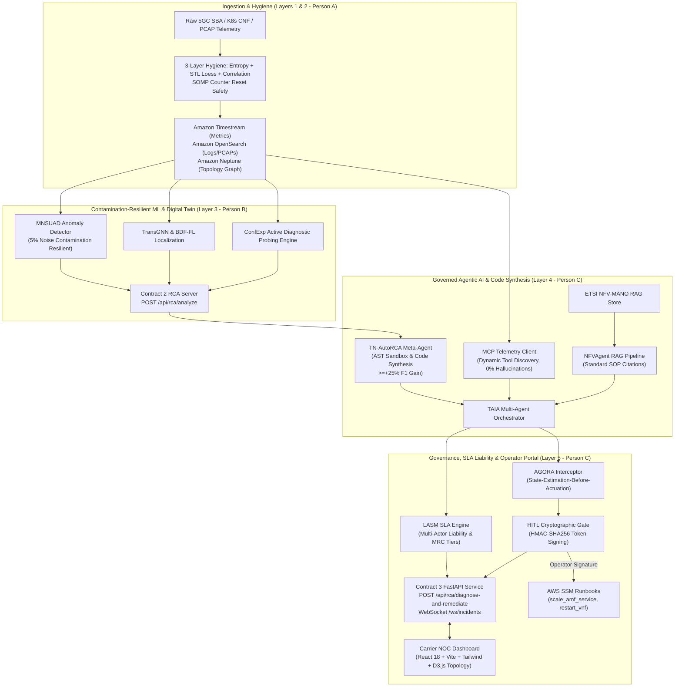

# Intelligent Root Cause Analysis (RCA) Framework for Telecom Cloud Services

Grounded in **15 peer-reviewed research papers (2023–2026)**, this repository contains the production-grade, carrier-grade Root Cause Analysis framework for Telecom Cloud Services (5G Core SBA, Kubernetes CNFs/VNFs, transport, and multi-cloud continuum).

---

## 👥 Contributors & Work Distribution

- **Person A (Data Pipeline & Infrastructure Engineer)**: Mohak Harsh — Telemetry Ingestion, 3-Layer Hygiene Pipeline, SOMP Normalization, Neptune Graph, PCAP Golden Flow extraction, MCP JSON-RPC Server, and Terraform IaC.
- **Person B (ML / AI Engine & Digital Twin Engineer)**: Sandarbh Gupta — Contamination-Resilient Anomaly Detection (MNSUAD & DAGMM), Adversarial 5GC Anomaly Detection (TeleGAN-Core), Spatio-Temporal Dual-Branch CNN-Transformer, Digital Twin Fault Localization (transGNN / BDF-FL), Active Diagnostic Probing (ConfExp), and Contract 2 FastAPI Server.
- **Person C (Agentic AI, SLA Liability & Operator Dashboard)**: Aarnav Mishra — Governed Agentic Reasoning (TN-AutoRCA Meta-Agent, NFVAgent RAG SOP citations, TAIA Multi-Agent Orchestrator), State-Estimation-Before-Actuation (AGORA Interceptor), Cryptographic Human-in-the-Loop Governance (HMAC-SHA256), Contractual SLA Liability Adjudication (LASM Engine with MRC penalties), Contract 3 API, and Carrier NOC D3.js Digital Twin Operator Portal.

---

## 🏛️ End-to-End System Architecture



---

## 📂 Repository Layout

```
├── .agents/skills/              # Antigravity IDE telecom-rca-framework skill
├── backend/                     # Person C: Governed Agentic AI, SLA Liability & Contract 3 Backend
│   ├── app/
│   │   ├── agents/              # TN-AutoRCA, NFVAgent RAG, ReAct MCP Agent, TAIA Orchestrator
│   │   ├── api/                 # Contract 3 REST endpoints, HITL signing, WebSocket streaming
│   │   ├── core/                # Configuration, logging, cryptographic HMAC tokens
│   │   └── services/            # AGORA interceptor, LASM SLA engine, Bedrock client, SSM service
│   ├── knowledge_base/          # 52 failure rules across 4 domains
│   └── tests/                   # Backend unit, integration, and coverage test suite (34 tests)
├── contracts/                   # Shared contracts, OpenAPI specs & Pydantic schemas
├── docs/                        # Specifications, PRD, architecture, and reports
│   ├── SYSTEM_SPECIFICATION_AND_ARCHITECTURE.md
│   ├── PROJECT_REQUIREMENTS.md
│   ├── IMPLEMENTATION_PLAN.md
│   ├── ARCHITECTURE.md          # Person C Architecture Blueprint
│   ├── API_DOCUMENTATION.md     # Person C REST & WebSocket API Docs
│   ├── LASM_SPECIFICATION.md    # Multi-Actor SLA Liability Engine Spec
│   ├── HITL_SECURITY_SPEC.md    # Cryptographic HITL Token Security Spec
│   ├── RUNBOOK.md               # Carrier NOC Operational Runbook
│   └── SETUP_GUIDE.md           # Developer & Operator Setup Guide
├── frontend/                    # Person C: Carrier NOC Portal (React 18 + Vite + TypeScript + D3)
│   ├── src/
│   │   ├── components/          # TopologyGraph (D3), ShapWaterfall, PropagationChain, SlaLiabilityTable
│   │   └── services/            # Backend API and WebSocket clients
│   └── tests/                   # Frontend Vitest test suite
├── infra/                       # Infrastructure as Code
│   ├── terraform/               # Person C AWS Step Functions, Amplify, IAM
│   ├── ssm_runbooks/            # Automated AWS SSM runbooks (scale_amf, restart_vnf)
│   └── step_functions/          # AWS Step Functions ASL orchestration definition
├── scripts/                     # Operational and demo scripts (run_demo.sh, generate_schemas.py)
├── src/                         # Person A & Person B: Data Ingestion, Hygiene, and ML Engine
│   ├── contracts/               # Shared Pydantic data contracts (Contract 1, 2, 3)
│   ├── graph/                   # Amazon Neptune Gremlin & NetworkX topology engine
│   ├── hygiene/                 # 3-Layer Shannon Entropy, STL Loess & SOMP pipeline
│   ├── ingest/                  # Telemetry ingesters (RCAEval, TN-RCA530, etc.)
│   ├── mcp/                     # Model Context Protocol (MCP) server & agent tools
│   ├── ml_engine/               # Person B: ML Engine, Digital Twin & Contract 2 Server
│   ├── pcap/                    # Wireshark/tshark extractor & 3GPP TS 23.502 golden flows
│   └── rag/                     # ETSI NFV-MANO SOP sliding-window vector store
├── tests/                       # Person A & B Automated test suite (34 passing tests)
├── docker-compose.yml           # Unified multi-service container orchestration
├── Makefile                     # Unified development and testing automation
├── pyproject.toml               # Unified project metadata and dependencies
└── requirements.txt             # Production pip requirements
```

---

## 🚀 Running Tests & Local Execution

### 1. Person C NOC Portal & Agentic Backend
```bash
# Install dependencies
make setup

# Run Person C test suite (pytest >=85% and vitest)
make test

# Launch FastAPI backend (:8000) and React NOC Portal (:3000)
make run
```
- **Carrier NOC Dashboard**: [http://localhost:3000](http://localhost:3000)
- **Backend API & Swagger Docs**: [http://localhost:8000/docs](http://localhost:8000/docs)
- **Health Check**: [http://localhost:8000/healthz](http://localhost:8000/healthz)

### 2. Person A & B Pipeline and ML Engine Tests
```bash
# Run Person A & B test suite (34 tests)
pytest tests/ -v
```

### 3. Start Contract 1 MCP Server & Contract 2 ML RCA Server
```bash
# Start MCP server (Port 8000)
uvicorn src.mcp.server:app --reload --port 8000

# Start Contract 2 ML RCA Server (Port 8001)
uvicorn src.ml_engine.server:app --reload --port 8001
```

---

## 📄 Documentation Index

- **[System Specification & Architecture Reference](docs/SYSTEM_SPECIFICATION_AND_ARCHITECTURE.md)**
- **[Project Requirements Document](docs/PROJECT_REQUIREMENTS.md)**
- **[12-Week Implementation Plan](docs/IMPLEMENTATION_PLAN.md)**
- **[Person C Architecture Blueprint](docs/ARCHITECTURE.md)**
- **[REST & WebSocket API Documentation](docs/API_DOCUMENTATION.md)**
- **[HITL Cryptographic Security Specification](docs/HITL_SECURITY_SPEC.md)**
- **[LASM SLA Liability Engine Specification](docs/LASM_SPECIFICATION.md)**
- **[Carrier NOC Operational Runbook](docs/RUNBOOK.md)**
- **[Live Demonstration Walkthrough Script](docs/DEMO_SCRIPT.md)**
- **[Cross-Team Integration Handover Package](docs/HANDOVER.md)**
