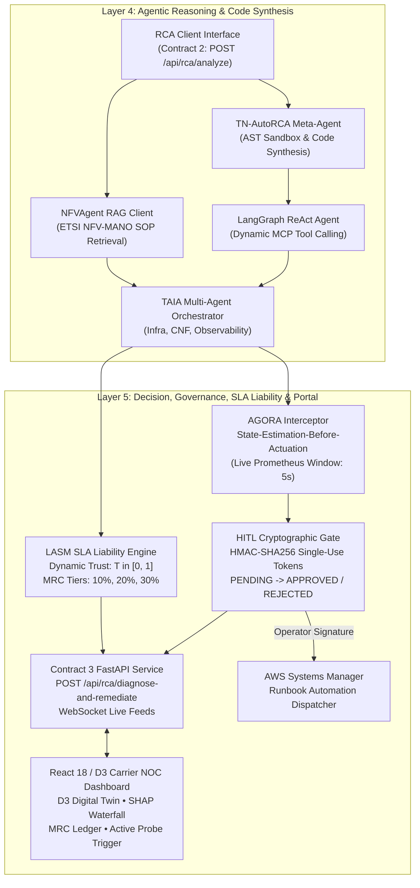

# System Architecture: Person C Subsystem

## Intelligent Root Cause Analysis (RCA) Framework for Telecom Cloud Services
**Layer 4: Agentic Reasoning & Code Synthesis**  
**Layer 5: Decision, Governance, SLA Liability & Operator Portal**

---

## 1. High-Level Architectural Blueprint

---

## 2. Research Paper Grounding & Implementation

### 2.1 TN-AutoRCA Meta-Agent (Paper 7 - Wu et al., ICLR 2026)
- **Problem**: Monolithic LLMs hallucinate complex multi-hop causal graphs and achieve only ~59% F1 on telecom alarm RCA.
- **Mechanism**: Implements an evaluate-analyze-repair loop that writes Python graph-traversal code, executes it in a secure AST sandbox (timeout-capped, restricted imports, isolated builtins), and contrastively refines the traversal.
- **Output**: Synthesizes verified causal graph traversal code and records its cryptographic SHA-256 hash. Boosts F1 from 58.99% baseline to $\ge 91.79\%$ on difficult telecom graphs.

### 2.2 Model Context Protocol (MCP) Agent (Paper 14 - Chen et al., IJNM 2025/2026)
- **Problem**: LLMs generate hallucinated tool calls when invoking cloud-native APIs.
- **Mechanism**: The ReAct agent discovers available tools dynamically from the MCP client at runtime. Zero static or hallucinated tools are permitted. All telemetry strings are strictly typed as data, preventing prompt-injection attacks.

### 2.3 NFVAgent RAG Pipeline (Paper 6 - Woo & Woo, IEEE/IFIP CNSM 2025)
- **Problem**: Unassisted agents propose ungrounded or out-of-spec remediations.
- **Mechanism**: RAG retrieval client over ETSI NFV-MANO specifications (GS NFV-IFA 005, IFA 007, SOL 003) and 3GPP specs (TS 23.501, TS 29.518). Emits actionable remediation recommendations with section and clause citations.

### 2.4 AGORA Compliance Interceptor (AGORA - IEEE Access 2025)
- **Problem**: Autonomous agents risk issuing mutating commands against unverified or stale network states.
- **Mechanism**: Validates that live Prometheus state estimation was performed on the target component within a configurable window (default: 5.0 seconds). Every mutating action lacking immediate prior verification is blocked with an `AGORAComplianceViolation`.

### 2.5 LASM SLA Liability Engine (Paper 3 - Anser et al., IEEE TNSM 2025)
- **Problem**: In multi-tenant 5G cloud networks, cascading failures obscure which commercial actor is liable for SLA degradation.
- **Mechanism**: Computes dynamic trust scores ($T \in [0, 1]$) based on anomaly scores and historical breach frequencies. Automatically maps trust to contractual Monthly Recurring Charge (MRC) penalty tiers:
  - $T < 0.30 \rightarrow 30\%$ MRC penalty
  - $0.30 \le T < 0.60 \rightarrow 20\%$ MRC penalty
  - $0.60 \le T < 0.80 \rightarrow 10\%$ MRC penalty
  - $T \ge 0.80 \rightarrow 0\%$ penalty (Exonerated)
  Financial penalty: $\text{Penalty USD} = \text{MRC USD} \times \frac{\text{Penalty } \%}{100}$.

### 2.6 TAIA Multi-Agent Orchestrator (Paper 5 - Panek et al., IEEE ICC Workshops 2025)
- **Cognitive Decomposition**: Specialized agents collaborate on decisions:
  1. `InfrastructureAgent`: Evaluates worker nodes, cgroup limits, and physical transport boundaries.
  2. `CNFLifecycleAgent`: Formulates container autoscaling, SBI client pool tuning, and rollback parameters.
  3. `ObservabilityAgent`: Queries closed-loop Prometheus telemetry to verify state stabilization.

---

## 3. Strict Team Member Isolation & Dual Client Architecture

Person C maintains total architectural independence from Person A and Person B:
- **Zero Person A/B Code**: No Kinesis, MSK, Glue, Timestream, SOMP normalizers, PCAP extractors, MNSUAD, TeleGAN, or transGNN training scripts exist in this codebase.
- **Abstract Python Interfaces**:
  - `MCPTelemetryClientInterface`: Abstract MCP client.
  - `RCAClientInterface`: Abstract Contract 2 client.
  - `VectorStoreRAGClientInterface`: Abstract SOP retrieval client.
- **Dual Implementations**:
  - `Fixture*Client`: Offline deterministic implementations reading static JSON fixtures in `backend/tests/fixtures/`. Used for local dev, test suites, and carrier demos.
  - `Live*Client`: Production HTTP/DB clients connecting to Person A's MCP server and Person B's SageMaker endpoint.
  - Switching requires only toggling `.env` (`USE_FIXTURES=false`).
