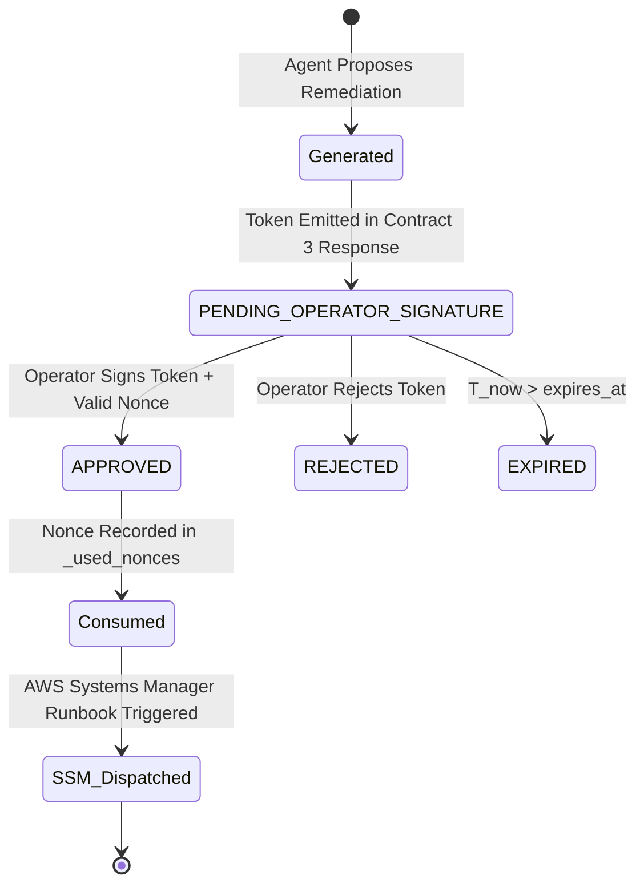

# Cryptographic Specification: Human-in-the-Loop (HITL) Governance

**Target Classification**: Carrier-Grade Control Plane Safety Standard  
**Compliance Standard**: 3GPP Security Architecture (TS 33.501) • ETSI NFV SEC 013  
**Implementation**: `backend/app/core/security.py`

---

## 1. Threat Model & Design Requirements

Autonomous generative AI agents possess write-access to carrier infrastructure (e.g., autoscaling, traffic migration, cgroup resizing). Executing unverified or spoofed commands in carrier control planes can induce catastrophic cascading outages.

To prevent unauthorized, replayed, or forged infrastructure mutations, Person C enforces strict cryptographic token governance:

1. **Contextual Binding**: Tokens are cryptographically bound to the tuple:
   $$\mathcal{T} = (\text{incident\_id}, \text{action}, \text{target}, \text{parameters}, \text{created\_at}, \text{expires\_at}, \text{nonce})$$
2. **Cryptographic Integrity**: Sealed using HMAC-SHA256 with 256-bit symmetric entropy (or Ed25519 asymmetric signatures).
3. **Temporal Bounding**: Tokens expire after a strict window (default: 60 minutes).
4. **Single-Use Replay Defense**: Each token embeds a unique 128-bit random nonce ($\mathcal{N} \in \{0, 1\}^{128}$) that is permanently consumed upon first verification.
5. **Operator Non-Repudiation**: Transition from `PENDING_OPERATOR_SIGNATURE` to `APPROVED` requires an explicit cryptographic operator signature string recorded in an append-only audit trail.

---

## 2. Token Life-Cycle State Machine

---

## 3. Mathematical Token Construction

### 3.1 Token Generation
Given incident context $I$, remediation action $A$, target $T$, parameters $P$, time $t_{\text{now}}$, window $\Delta t$, and cryptographic secret $K$:

1. Generate random nonce:
   $$\mathcal{N} = \text{UUIDv4}()$$
2. Construct canonical payload JSON $\mathcal{P}$:
   $$\mathcal{P} = \text{sort\_keys}\left(\{ \text{incident\_id}: I, \text{action}: A, \text{target}: T, \text{parameters}: P, \text{created\_at}: t_{\text{now}}, \text{expires\_at}: t_{\text{now}} + \Delta t, \text{nonce}: \mathcal{N} \}\right)$$
3. Compute signature $\mathcal{S}$:
   $$\mathcal{S} = \text{HMAC-SHA256}(K, \text{UTF8}(\mathcal{P}))$$
4. Emit URL-safe Base64 token:
   $$\text{Token} = \text{Base64UrlEncode}(\text{JSON}(\{ \text{payload}: \mathcal{P}, \text{signature}: \mathcal{S} \}))$$

### 3.2 Verification Algorithm
When `POST /api/hitl/approve` is invoked with `(Token, OperatorSignature)`:
1. Decode Base64 string and parse JSON. Reject if malformed.
2. Re-compute HMAC-SHA256 over canonical payload with secret $K$.
   $$\text{Check: } \text{constant\_time\_compare}(\mathcal{S}_{\text{provided}}, \mathcal{S}_{\text{expected}}) == \text{True}$$
   If comparison fails: **Reject with 403 Forbidden (Tampering Detected)**.
3. Check current time $t$:
   $$\text{Check: } t < \mathcal{P}.\text{expires\_at}$$
   If expired: **Reject with 403 Forbidden (Token Expired)**.
4. Check nonce uniqueness:
   $$\text{Check: } \mathcal{P}.\text{nonce} \notin \text{ConsumedNonces}$$
   If nonce exists: **Reject with 403 Forbidden (Replay Attack Detected)**.
5. Consume nonce:
   $$\text{ConsumedNonces} \leftarrow \text{ConsumedNonces} \cup \{ \mathcal{P}.\text{nonce} \}$$
6. Append immutable entry to audit log with operator signature, timestamp, and action parameters.
