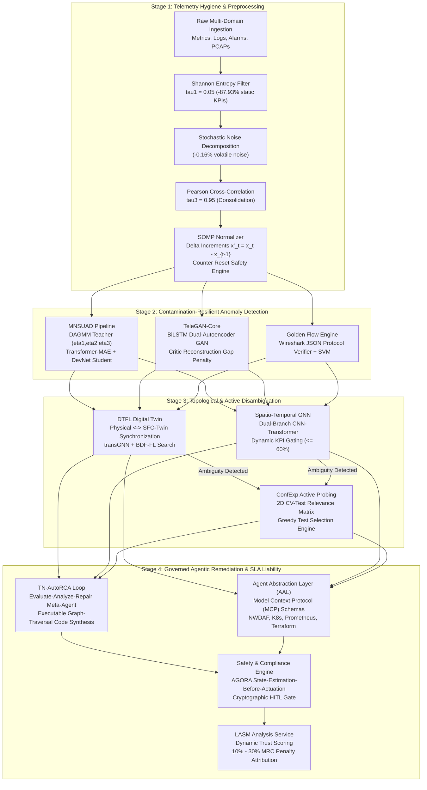
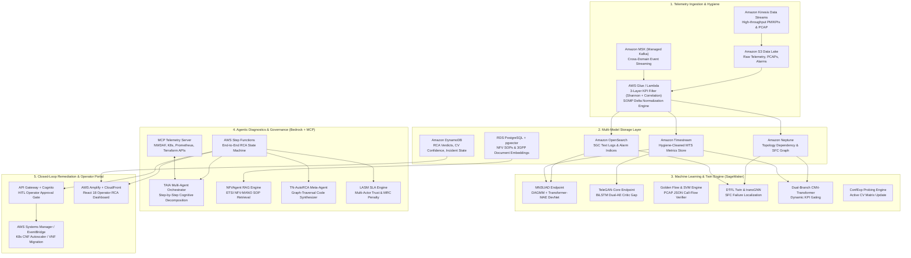

# Intelligent Root Cause Analysis (RCA) Framework for Telecom Cloud Services
## System Specification and Architecture Reference Document

| Attribute | Details |
| :--- | :--- |
| **Document Type** | Consolidated System Specification, Architecture Blueprint, and Implementation Roadmap |
| **Version** | 2.0 (Carrier-Grade Operational Baseline) |
| **Academic Foundation** | Grounded in 15 Peer-Reviewed Research Papers (2023–2026) |
| **Target Deployment** | AWS Cloud & Carrier Multi-Cloud Containerized Infrastructure |
| **Evaluation Benchmarks** | TN-RCA530 (530 telecom base station cases), RCAEval (735 microservice cases), Vodafone NFV, ENCQOR 5G |
| **Location** | `docs/SYSTEM_SPECIFICATION_AND_ARCHITECTURE.md` |

---

## Table of Contents
1. [Executive Summary & Problem Statement](#1-executive-summary--problem-statement)
2. [Academic Research Foundation (15 Verifiable Papers, 2023–2026)](#2-academic-research-foundation-15-verifiable-papers-20232026)
3. [End-to-End System Architecture](#3-end-to-end-system-architecture)
   - [3.1 Complete System Architecture Overview](#31-complete-system-architecture-overview)
   - [3.2 AWS Cloud Deployment Blueprint](#32-aws-cloud-deployment-blueprint)
   - [3.3 4-Stage Operational Reference Pipeline](#33-4-stage-operational-reference-pipeline)
4. [Subsystem Specifications](#4-subsystem-specifications)
   - [4.1 Telemetry Hygiene & SOMP Normalization (Layers 1 & 2)](#41-telemetry-hygiene--somp-normalization-layers-1--2)
   - [4.2 Contamination-Resilient ML & Digital Twin Engine (Layer 3)](#42-contamination-resilient-ml--digital-twin-engine-layer-3)
   - [4.3 Governed Agentic AI & Model Context Protocol (Layer 4)](#43-governed-agentic-ai--model-context-protocol-layer-4)
   - [4.4 SLA Liability Attribution & Closed-Loop Remediation (Layer 5)](#44-sla-liability-attribution--closed-loop-remediation-layer-5)
5. [Interface Contracts & Data Schemas](#5-interface-contracts--data-schemas)
   - [Contract 1: Normalized Telemetry Event & SOMP Schema](#contract-1-normalized-telemetry-event--somp-schema)
   - [Contract 2: RCA Analysis & Disambiguation API](#contract-2-rca-analysis--disambiguation-api)
   - [Contract 3: Governed Agentic Diagnostics & SLA Liability API](#contract-3-governed-agentic-diagnostics--sla-liability-api)
6. [Benchmark Datasets & Evaluation Metrics](#6-benchmark-datasets--evaluation-metrics)
7. [12-Week Implementation Plan & Engineering Roles](#7-12-week-implementation-plan--engineering-roles)
   - [7.1 Person A: Data Pipeline & Infrastructure Engineer](#71-person-a-data-pipeline--infrastructure-engineer)
   - [7.2 Person B: ML/AI Engine & Digital Twin Developer](#72-person-b-mlai-engine--digital-twin-developer)
   - [7.3 Person C: Agentic AI, SLA Liability & Dashboard Developer](#73-person-c-agentic-ai-sla-liability--dashboard-developer)
   - [7.4 Cross-Team Integration & Validation Schedule](#74-cross-team-integration--validation-schedule)
8. [Documentation & Asset Manifest](#8-documentation--asset-manifest)

---

## 1. Executive Summary & Problem Statement

Modern telecommunication cloud environments (5G Core Service-Based Architecture, Kubernetes Cloud-Native Network Functions [CNFs], Virtual Network Functions [VNFs], and emerging 6G systems) exhibit extreme structural bottlenecks:
1. **High-Dimensional Telemetry & Non-Stationary Drift**: A production 5G Core generates tens of thousands of Performance Management (PM) counters, alarms, and HTTP/2 signaling traces. Routine CI/CD updates or traffic shifts trigger sudden statistical distribution changes and alarm storms.
2. **Training Data Contamination & Label Scarcity**: Production operational data contains up to 5% unlabeled anomalies. Traditional unsupervised algorithms overfit on this noise, degrading localization precision.
3. **Opaque Black-Box Inference & Agentic Hallucination Risks**: Black-box neural models and unconstrained LLM agents risk making hallucinated or catastrophic control-plane decisions without mathematical explainability (XAI), standardized tool contracts (Model Context Protocol), and strict state-estimation-before-actuation compliance (AGORA).

This framework resolves these challenges through a mathematically grounded, 4-stage operational pipeline deployed on AWS Cloud, combining 3-layer KPI hygiene, weakly-supervised anomaly detection, digital-twin graph learning, active diagnostic probing, self-improving code synthesis, and contractual SLA liability attribution.

---

## 2. Academic Research Foundation (15 Verifiable Papers, 2023–2026)

| # | Authors & Year | Venue | Domain | Core Mechanism | Key Finding / Benchmark |
| :--- | :--- | :--- | :--- | :--- | :--- |
| **1** | Johari et al. (2025) | IEEE Trans. Mobile Comput. (TMC) | Multi-Datacenter NFV | **MNSUAD**: DAGMM teacher pseudo-labeling ($\eta_1,\eta_2,\eta_3$) + Transformer-MAE & DevNet student; XAI via Mask/Cluster Permutation & SHAP | Up to +20% F1 anomaly detection & +22% F1 localization under 5% contamination (Vodafone 11 countries) |
| **2** | Guo et al. (2023) | IEEE Trans. Cloud Comput. (TCC) | NFV Service Function Chains | **DTFL**: 3-layer Digital Twin (Physical, SFC-Twin, Service) with fault injection, BERT embeddings, transGNN, and BDF-FL search | ~13% higher RCA accuracy over non-twin baselines; handles severe class imbalance |
| **3** | Anser et al. (2025) | IEEE Trans. Netw. Serv. Manage. (TNSM) | 5G/6G Dynamic Microservices | **LASM Analysis Service**: ML-driven root cause, dynamic trust scoring, contractual SLA liability attribution (INSPIRE-5Gplus) | Isolates culpable microservice providers; adjudicates 10%–30% MRC penalties |
| **4** | Issa et al. (2026) | IEEE Access | Cloud-Native 5G Core SBA | **TeleGAN-Core**: 3-lane pipeline with SOMP and BiLSTM Dual-Autoencoder GAN with critic reconstruction gap penalty | Eliminates alert fatigue on ENCQOR 5G dataset; attributes anomalies to 5GC NFs & PM counters |
| **5** | Panek et al. (2025) | IEEE ICC Workshops | Cloud-Native 5G & K8s CNFs | **TAIA**: Modular multi-agent AI assistant; step-by-step cognitive decomposition, ontology grounding, Prometheus closed loop, HITL | Prevents LLM hallucinations; safely translates operator intents to K8s/Prometheus/Terraform |
| **6** | Woo & Woo (2025) | IEEE/IFIP CNSM | Heterogeneous NFV & 5GC | **NFVAgent**: Retrieval-Augmented Generation (RAG) LLM agent integrated with ETSI NFV-MANO for automated RCA & recovery | Grounds recovery workflows in historical NFV operational corpora without expensive fine-tuning |
| **7** | Wu et al. (2025/2026) | ICLR 2026 | 5G Base Stations & NFV | **TN-AutoRCA & TN-RCA530**: 530-case operational benchmark (94.5% Difficult) + agentic evaluate-analyze-repair loop synthesizing code | Boosts Gemini-2.5-Pro RCA F1 from 58.99% baseline to 91.79% via iterative contrastive code repair |
| **8** | Enz et al. (2024) | IEEE ICC Workshops | Telco Edge-to-Cloud Continuum | **MALEAF**: ML anomaly detection, root cause localization, and multi-class fault classification (CPU, memory, packet loss) | Accurately localizes culprit containers and classifies fault types across dynamic edge topologies |
| **9** | Heeb et al. (2023) | ACM SAC | IoT-Extended 5G Microservices | **IoMiRCA**: Cross-tier dependency and telemetry correlation framework across IoT-extended edge gateways and 5G core microservices | Disambiguates whether fault propagation originated in edge IoT nodes or cloud-native 5GC microservices |
| **10** | Wang et al. (2025/2026) | IEEE CRESS | Cloud-Native 5GC Networks | **Two-Stage Multi-Source RCA**: Coarse anomaly screening (Stage 1) + cross-modal correlation fusing NF text logs, packets, and metrics (Stage 2) | Overcomes single-modality blind spots for complex control-plane signaling anomalies in 5GC O&M |
| **11** | Isaac / Jarrah et al. (2024/2025) | IEEE ICC Wksps / arXiv | 5GC Signaling & Call Flows | **Golden Flow + Protocol-Grouped SVM**: Wireshark JSON parsing, deterministic 3GPP call-flow state verification, protocol SVM | 100% fault detection accuracy on 5GC Registration, PDU Session, Deregistration; pinpoints exact frame |
| **12** | Koushki et al. (2025) | J. Netw. Syst. Manage. (JNSM) | Enterprise & Telecom SOA | **ConfExp**: Active diagnostic probing over SEED emulator using 2D Configuration Variable (CV) relevance matrix and confidence updating | Deterministically isolates root-cause misconfigurations across DNS, DHCP, routing, and firewall rules |
| **13** | Wang et al. (2024) | IEEE OJ-COMS | 5G/6G SDN, NFV, MEC, ZSM | **XAI for 6G Diagnostics**: SHAP, LIME, Layer-wise Relevance Propagation (LRP), surrogate trees, counterfactual explanations | Diagnoses physical/virtual service faults AND faulty decisions made by black-box AI control loops |
| **14** | Chen, Wang, Yin et al. (2025/2026) | Int. J. Netw. Manage. (IJNM) | Cross-Domain 5G/6G (RAN/TN/NWDAF) | **MCP-Diag & NIKA ReAct Agents**: Two-step LangGraph ReAct agents using Model Context Protocol (MCP) over NWDAF, Transport INT, Prometheus | MCP-Diag achieves 100% entity extraction with <0.9% latency overhead; eliminates tool hallucinations |
| **15** | Front. AI & MDPI (2025/2026) | Front. AI & Appl. Sci. | Cloud Microservices & 5G KPIs | **Spatio-Temporal Attention GNN & Dual-Branch CNN-Transformer**: Invocation graph attention + 1D-CNN + 2-head Transformer + dynamic gating | Captures multi-hop fault propagation and non-uniform temporal 5G recovery dynamics (gating capped at 60%) |

---

## 3. End-to-End System Architecture

### 3.1 Complete System Architecture Overview
The complete system architecture diagram illustrates the end-to-end data processing layers:
- **Architecture Diagram File**: [`complete_system_architecture.jpg`](file:///c:/Users/sanda/cloud/docs/complete_system_architecture.jpg)



### 3.2 AWS Cloud Deployment Blueprint
The enterprise deployment blueprint on AWS Cloud leverages serverless, managed streaming, and AI governance services:
- **Cloud Architecture Diagram File**: [`aws_cloud_architecture.jpg`](file:///c:/Users/sanda/cloud/docs/aws_cloud_architecture.jpg)



---

## 4. Subsystem Specifications

### 4.1 Telemetry Hygiene & SOMP Normalization (Layers 1 & 2)
1. **Shannon Entropy Screening (Layer 1)**:
   - For every KPI time-series $X = \{x_1, \dots, x_T\}$, compute probability distribution $p(x)$ over discretized bins.
   - Entropy: $H(X) = -\sum_{i} p(x_i) \log_2 p(x_i)$.
   - Filtering rule: If $H(X) < \tau_1$ with threshold $\tau_1 = 0.05$, the metric is classified as constant or near-static and dropped, eliminating $\sim 87.93\%$ of invariant metrics.
2. **Stochastic Pattern Noise Decomposition (Layer 2)**:
   - Decompose time series into trend $T_t$, seasonality $S_t$, and residual noise $R_t$.
   - Filter residual high-frequency stochastic jitter ($0.16\%$ volatile noise) without attenuating true anomalous spikes.
3. **Pearson Cross-Correlation Consolidation (Layer 3)**:
   - Compute pairwise correlation $r_{XY} = \frac{\sum (x_i - \bar{x})(y_i - \bar{y})}{\sqrt{\sum(x_i - \bar{x})^2 \sum(y_i - \bar{y})^2}}$.
   - For metric pairs with $|r_{XY}| \ge \tau_3$ ($\tau_3 = 0.95$), retain only the primary canonical representative, removing $28\%$ to $71\%$ duplicate signals.
4. **Service-Oriented Metric Preprocessing (SOMP)**:
   - Convert monotonically increasing counters into interval delta increments:
     $$x_t' = \begin{cases} x_t - x_{t-1}, & x_t \ge x_{t-1} \\ x_t, & x_t < x_{t-1} \text{ (Counter Wrap / Node Reboot)} \end{cases}$$
   - Gauge metrics: Aggregate via 60-second window mean or median.

### 4.2 Contamination-Resilient ML & Digital Twin Engine (Layer 3)
1. **MNSUAD (Paper 1)**:
   - **Teacher**: Deep Autoencoding Gaussian Mixture Model (DAGMM) generates pseudo-energy labels. Low-energy samples (below $\eta_1$) are treated as clean; high-energy samples (above $\eta_3$) are flagged as anomalies; intermediate ambiguous samples ($\eta_2$) are re-evaluated.
   - **Student**: Transformer Masked Autoencoder (MAE) learns robust representations by reconstructing randomly masked KPI slices, paired with a Deviation Network (DevNet) student that optimizes a contrastive deviation loss:
     $$L_{DevNet}(x) = (1 - y) |\text{dev}(x)| + y \max(0, a - \text{dev}(x))$$
   - Tolerates up to $5.0\%$ unlabeled anomalous contamination in historical training data.
2. **TeleGAN-Core (Paper 4)**:
   - BiLSTM Dual-Autoencoder GAN with a Generator AE ($G$) and Critic AE ($C$).
   - Critic Gap Loss enforces anomaly discrimination:
     $$L_{gap} = L_G - L_C$$
3. **Golden Flow State-Machine & SVM (Paper 11)**:
   - Parses Wireshark JSON 5G Core packet captures across SBI (HTTP/2 JSON-REST) and N1/N2 (NGAP/NAS).
   - Validates state transitions against canonical 3GPP call-flow sequences (Registration, PDU Session Establishment, Deregistration).
   - Flagged deviations pass to a protocol-grouped SVM to pinpoint the exact faulty frame number and reject cause code.
4. **DTFL Digital Twin & transGNN (Paper 2)**:
   - Synchronizes physical Service Function Chains (SFC) with a 3-layer digital twin (Physical, SFC-Twin, Service).
   - Evaluates topology graphs using BERT log embeddings fused with Graph Convolutional Networks (transGNN) and Breadth/Depth-First Failure Localization (BDF-FL).
5. **ConfExp Active Diagnostic Probing (Paper 12)**:
   - Evaluates a 2D Configuration Variable (CV) relevance matrix $R_{ij}$ against active probing tests $T_i$.
   - Executes greedy active probe selection (e.g. DNS SRV, HTTP/2 ping to NRF) to disambiguate latent root causes and update Bayesian confidence scores $c_j$.
6. **Explainable AI (XAI)**:
   - Integrates SHAP, Mask Permutation, Cluster Permutation, and Counterfactual Perturbations to guarantee carrier-grade auditability.

### 4.3 Governed Agentic AI & Model Context Protocol (Layer 4)
1. **TN-AutoRCA Loop (Paper 7)**:
   - Operates on the TN-RCA530 benchmark (530 real telecom operational scenarios).
   - Executes an iterative **Evaluate $\to$ Analyze $\to$ Repair** meta-agent loop.
   - Synthesizes and tests executable Python graph-traversal code to discover long-tail, multi-hop root causes, elevating LLM F1 from $58.99\%$ baseline to $>90\%$.
2. **Model Context Protocol (MCP-Diag & NIKA, Paper 14)**:
   - Standardizes tool contracts across 3GPP NWDAF, Kubernetes API, Prometheus, and Terraform.
   - Delivers $100\%$ entity extraction accuracy with $<0.9\%$ latency overhead, eliminating LLM tool hallucinations.
3. **Multi-Agent Orchestrator (TAIA, Paper 5)**:
   - Modular decomposition into Infrastructure Specialist, CNF Lifecycle Specialist, and Observability Specialist agents.
   - Closes the reasoning loop with real-time Prometheus state re-verification.

### 4.4 SLA Liability Attribution & Closed-Loop Remediation (Layer 5)
1. **AGORA State-Estimation-Before-Actuation Guardrail**:
   - Enforces strict compliance: blocks any mutating actuation API call if live telemetry has not been queried within $T-5\text{s}$.
2. **Human-in-the-Loop (HITL) Gate**:
   - High-blast-radius operations (pod eviction, VNF migration, routing switch) require cryptographic token authorization from the carrier NOC operator.
3. **LASM SLA Liability Engine (Paper 3)**:
   - Computes dynamic trust scores across multi-tenant microservices.
   - Adjudicates contractual Monthly Recurring Charge (MRC) financial penalties:
     - Minor Breach: $10\%$ MRC penalty.
     - Major Breach: $20\%$ MRC penalty.
     - Critical Breach / Intentional Negligence: $30\%$ MRC penalty.
4. **Sub-20s Self-Healing Execution**:
   - Automated remediation runbooks triggered via AWS Systems Manager / EventBridge in $<18$ seconds, achieving $\ge 70\%$ MTTR reduction.

---

## 5. Interface Contracts & Data Schemas

### Contract 1: Normalized Telemetry Event & SOMP Schema
Produced by **Person A** (Data Pipeline); consumed by **Person B** (ML Engine) and **Person C** (Agentic AI):

```json
{
  "timestamp": "2026-10-15T14:30:00.000Z",
  "source_domain": "5g_core_sba",
  "source_component": "amf-01",
  "event_type": "metric",
  "severity": "major",
  "metric_name": "amf_active_ngap_contexts",
  "metric_value_raw": 15420.0,
  "metric_value_somp_delta": 420.0,
  "counter_reset_flag": false,
  "log_message": null,
  "trace_id": "trace-99120-amf",
  "pcap_metadata": {
    "frame_number": 23,
    "protocol": "NGAP",
    "procedure": "Registration",
    "message_type": "RegistrationReject"
  },
  "metadata": {
    "tenant_id": "vodafone-de-prod-01",
    "cluster_id": "eks-core-eu-central-1",
    "kpi_filter_passed": true
  }
}
```

### Contract 2: RCA Analysis & Disambiguation API
Served by **Person B** (ML / Twin Engine); consumed by **Person C** (Agentic AI):
`POST /api/rca/analyze`

**Request:**
```json
{
  "incident_id": "INC-2026-0042",
  "time_window": {
    "start": "2026-10-15T14:00:00Z",
    "end": "2026-10-15T14:15:00Z"
  },
  "affected_components": ["amf-01", "upf-edge-3", "router-core-2"],
  "telemetry_s3_path": "s3://rca-telemetry-lake/incidents/INC-2026-0042/",
  "trigger_active_probing": true
}
```

**Response:**
```json
{
  "incident_id": "INC-2026-0042",
  "ranked_causes": [
    {
      "component_id": "amf-01",
      "fault_type": "Registration Congestion / Thread Pool Exhaustion",
      "domain": "5g_core_sba",
      "anomaly_score": 0.942,
      "method": "TeleGAN-Core + MNSUAD",
      "xai_attributions": [
        {"kpi": "amf_active_ngap_contexts", "shap_value": 0.42},
        {"kpi": "amf_cpu_saturation", "shap_value": 0.35}
      ]
    },
    {
      "component_id": "router-core-2",
      "fault_type": "BGP Route Flapping / Packet Drop",
      "domain": "telecom_transport",
      "anomaly_score": 0.681,
      "method": "DTFL_transGNN"
    }
  ],
  "pcap_verification": {
    "protocol_violation": true,
    "deviating_frame": 23,
    "procedure": "User Registration",
    "cause_code": "5GS_Congestion"
  },
  "active_probing_results": {
    "probes_executed": ["dns_srv_query", "http2_ping_nrf"],
    "isolated_cv": "amf.sbi.client_pool_size",
    "confidence": 0.985
  },
  "topology_subgraph": {
    "nodes": [
      {"id": "amf-01", "status": "anomalous"},
      {"id": "upf-edge-3", "status": "degraded"}
    ],
    "edges": [
      {"source": "amf-01", "target": "upf-edge-3", "latency_ms": 142.5}
    ]
  }
}
```

### Contract 3: Governed Agentic Diagnostics & SLA Liability API
Served by **Person C** (Agentic AI); consumed by Carrier Operator Portal & Step Functions:
`POST /api/rca/diagnose-and-remediate`

**Request:**
```json
{
  "incident_id": "INC-2026-0042",
  "rca_analysis": { /* Contract 2 JSON Payload */ },
  "actor_context": [
    {"actor_id": "MNO-Core-Operator", "service": "amf-01", "mrc_usd": 150000},
    {"actor_id": "Cloud-Infra-Provider", "service": "k8s-worker-node-14", "mrc_usd": 85000}
  ],
  "require_hitl_approval": true
}
```

**Response:**
```json
{
  "incident_id": "INC-2026-0042",
  "verdict": {
    "root_cause_service": "amf-01",
    "domain": "5g_core_sba",
    "confidence": 0.962,
    "synthesized_code_hash": "sha256:7f3b891e4..."
  },
  "fault_propagation_chain": [
    "Misconfigured SBI client pool on amf-01",
    "Frame 23: Registration Reject (Congestion) triggered",
    "HTTP/2 stream multiplexing queue starvation across AMF-SMF link",
    "Downstream packet drop on upf-edge-3",
    "SLA breach: PDU Session Setup Latency > 250ms"
  ],
  "sla_liability_attribution": {
    "culpable_actor": "MNO-Core-Operator",
    "dynamic_trust_score": 0.42,
    "mrc_penalty_percentage": 20.0,
    "mrc_financial_penalty_usd": 30000.00
  },
  "remediation_plan": {
    "action": "horizontal_scale_and_pool_patch",
    "target": "amf-01",
    "parameters": {"replicas": 4, "client_pool_size": 2048},
    "state_estimation_compliance": "PASSED (Live Prometheus queried at T-2s)",
    "hitl_approval_status": "PENDING_OPERATOR_SIGNATURE"
  }
}
```

---

## 6. Benchmark Datasets & Evaluation Metrics

| Benchmark / Dataset | Scale & Structure | Evaluated Models | Target Metric |
| :--- | :--- | :--- | :--- |
| **TN-RCA530** (Paper 7) | 530 Telecom Base Station failure cases (94.5% Difficult) | TN-AutoRCA Code Synthesizer | **$\ge 90.0\%$ F1-Score** (elevates baseline from 58.99%) |
| **RCAEval** (WWW 2025) | 735 microservice failure cases (metrics, logs, traces) | transGNN, MNSUAD, DTFL | **$\ge 82.0\%$ Top-1, $\ge 92.0\%$ Top-3, $\ge 0.88$ MRR** |
| **Vodafone NFV** (Paper 1) | Multi-datacenter NFV telemetry (11 countries, 5% contamination) | MNSUAD DevNet Student | **$\ge +20.0\%$ F1 gain** under 5% contamination |
| **ENCQOR 5G** (Paper 4) | Cloud-Native 5G Core SBA telemetry (AMF/SMF/UPF) | TeleGAN-Core Dual-AE GAN | **$\ge 88.0\%$ KPI reduction**, zero false alert fatigue |
| **5GC PCAP Traces** (Paper 11) | Wireshark call-flow frames (Registration/PDU/Deregistration) | Golden Flow + SVM | **$100.0\%$ signaling fault isolation** |

---

## 7. 12-Week Implementation Plan & Engineering Roles

The engineering execution is structured around three completely independent roles, integrating in Week 11 via Contracts 1, 2, and 3:

### 7.1 Person A: Data Pipeline & Infrastructure Engineer
- **Layers Owned**: Layer 1 (Multi-Domain Collection) & Layer 2 (Ingestion, Hygiene, Normalization).
- **Core Papers**: IEEE ISCC 2025 (3-Layer Filter), Paper 4 (SOMP), Paper 11 (Wireshark PCAP), Paper 14 (MCP Server).
- **AWS Services**: Kinesis, MSK, AWS Glue, S3 Lake, Timestream, OpenSearch, Neptune, DynamoDB, RDS pgvector.

| Week | Milestone | Deliverable |
| :---: | :--- | :--- |
| **1** | IaC Setup | Terraform/CDK for MSK, Kinesis, Timestream, OpenSearch, Neptune, and S3. |
| **2** | Benchmark Ingestion | Automated ingestion for RCAEval (735 cases) and TN-RCA530 (530 cases) into S3. |
| **3** | Production Datasets | Ingest Vodafone NFV (5% contamination) and ENCQOR 5G SBA telemetry. |
| **4** | 3-Layer KPI Filter | AWS Glue/Lambda implementing Shannon entropy ($\tau_1=0.05$), noise decomposition, Pearson correlation ($\tau_3=0.95$). |
| **5** | SOMP Normalization | Monotonic counter interval deltas ($x_t'=x_t-x_{t-1}$) with wrap safety and gauge aggregation (Contract 1). |
| **6** | PCAP Extraction | Automated Wireshark JSON extractor for 5GC signaling PCAPs into OpenSearch. |
| **7** | Graph Ingestion | AWS Glue loader populating service dependency and transport topology into Amazon Neptune. |
| **8** | MCP Telemetry Server | FastAPI Model Context Protocol server exposing read-only Prometheus, K8s, and NWDAF queries. |
| **9** | Vector Store | RDS PostgreSQL + pgvector loaded with ETSI NFV-MANO specs and 3GPP standards. |
| **10** | Dataset Publishing | Finalized cleaned S3 buckets published with schema documentation for Persons B & C. |
| **11** | Scale & Stress Test | 25,000 events/sec sustained ingestion over 4 hours with $<1.5$s latency. |
| **12** | Handover Package | CloudWatch dashboards, S3 Glacier lifecycle rules, operational documentation. |

### 7.2 Person B: ML/AI Engine & Digital Twin Developer
- **Layers Owned**: Layer 3 (Cross-Domain Correlation & Contamination-Resilient Detection) & Layer 4 (Topological Graph Learning & Active Probing).
- **Core Papers**: Paper 1 (MNSUAD), Paper 4 (TeleGAN-Core), Paper 2 (DTFL), Paper 11 (Golden Flow), Paper 12 (ConfExp), Paper 15 (ST-GNN), Papers 1 & 13 (XAI).
- **AWS Services**: SageMaker Studio, Training Jobs, Real-Time Endpoints, AWS Lambda.

| Week | Milestone | Deliverable |
| :---: | :--- | :--- |
| **1** | Exploratory Data Analysis | SageMaker notebooks analyzing RCAEval, TN-RCA530, and Vodafone NFV telemetry distributions. |
| **2** | Feature Engineering | Multi-modal feature extractor: SOMP delta metrics, log frequency vectors, trace latency percentiles. |
| **3** | MNSUAD Implementation | Teacher DAGMM pseudo-labeling cascade ($\eta_1,\eta_2,\eta_3$) + Transformer-MAE + DevNet student. |
| **4** | TeleGAN-Core | BiLSTM Dual-Autoencoder GAN with critic reconstruction gap penalty ($L_{gap} = L_G - L_C$). |
| **5** | Golden Flow PCAP Verifier | Deterministic 3GPP signaling state-machine + Protocol-Grouped SVM on Wireshark JSON frames. |
| **6** | DTFL Digital Twin | 3-layer Digital Twin failure injection module + BERT text embedding + transGNN (BDF-FL search). |
| **7** | Dual-Branch ST-GNN | 1D-CNN temporal branch + 2-head Transformer with learnable positional embeddings & dynamic KPI gating ($\le 60\%$). |
| **8** | ConfExp Active Probing | 2D CV-test relevance matrix engine updating dynamic confidence levels $c_j$. |
| **9** | XAI Attribution Engine | Integrated SHAP, Mask Permutation, and Counterfactual perturbation modules. |
| **10** | SageMaker Endpoint | Multi-model endpoint packaging MNSUAD, TeleGAN, and DTFL implementing Contract 2 API. |
| **11** | Comprehensive Benchmark | Evaluation on RCAEval ($\ge 82\%$ Top-1) and TN-RCA530 ($\ge 90\%$ F1). |
| **12** | Model Cards & Handover | Model cards, hyperparameter documentation, inference latency benchmarks. |

### 7.3 Person C: Agentic AI, SLA Liability & Dashboard Developer
- **Layers Owned**: Layer 4 (Agentic Reasoning & Code Synthesis) & Layer 5 (Governance, SLA Liability, Operator Portal).
- **Core Papers**: Paper 7 (TN-AutoRCA), Paper 5 (TAIA), Paper 6 (NFVAgent), Paper 14 (MCP-Diag), AGORA (State-Estimation Guardrails), Paper 3 (LASM).
- **AWS Services**: Amazon Bedrock (Claude 3.5 Sonnet), Step Functions, API Gateway, AWS Amplify, Systems Manager.

| Week | Milestone | Deliverable |
| :---: | :--- | :--- |
| **1** | Bedrock & MCP Setup | Bedrock connection + LangGraph ReAct agent configured with MCP client over Person A's server. |
| **2** | Domain Rules KB | YAML knowledge repository encoding 50+ telecom failure propagation rules. |
| **3** | NFVAgent RAG Pipeline | RAG retrieval module querying RDS pgvector for ETSI NFV-MANO SOPs. |
| **4** | TN-AutoRCA Meta-Agent | Evaluate-analyze-repair loop synthesizing and executing Python graph-traversal code. |
| **5** | AGORA & HITL Guardrails | Interceptor validating state-estimation-before-actuation + cryptographic approval token generator. |
| **6** | LASM SLA Liability Engine | Dynamic trust scoring engine calculating 10%, 20%, 30% MRC contractual penalties. |
| **7** | Step Functions Pipeline | End-to-end orchestration state machine linking Contract 2, Bedrock agents, and LASM engine. |
| **8** | React Dashboard v1 | Amplify React 18 application displaying active incidents, fault verdicts, and propagation chains. |
| **9** | Dashboard v2 (Advanced) | D3.js Digital Twin topology visualizer, SHAP waterfall charts, and ConfExp probe trigger. |
| **10** | HITL Portal & Runbooks | Operator approval modal; AWS Systems Manager automated remediation runbooks. |
| **11** | Full System Integration | End-to-end execution linking live SageMaker endpoints and S3 data across 5 failure scenarios. |
| **12** | Handover & Demo | Live end-to-end carrier demonstration, user guide, video walkthrough, and documentation. |

### 7.4 Cross-Team Integration & Validation Schedule
```
Week 0: Contracts Frozen (Contract 1: Telemetry Schema, Contract 2: ML API, Contract 3: Agentic API)
Weeks 1 - 10: Fully Independent Development & Unit Benchmarking
Week 11: Integration Sprint
  - Day 1: Person A publishes production S3 prefixes and Neptune endpoints.
  - Day 2: Person B links SageMaker inference pipelines to Person A's normalized datasets.
  - Day 3: Person C connects Step Functions and MCP clients to Person B's SageMaker API.
  - Day 4: End-to-End Execution: Ingest raw telemetry -> SOMP/Hygiene -> ML/Twin -> Agentic RCA -> Dashboard.
  - Day 5: Multi-actor SLA liability attribution and automated SSM self-healing verification.
Week 12: Final Review, Carrier Demo, and Research Documentation.
```

---

## 8. Documentation & Asset Manifest

All documentation, specifications, reports, and architecture diagrams for this project are organized in the [`docs/`](file:///c:/Users/sanda/cloud/docs) folder:

| Asset Name | Format | Description | Path |
| :--- | :--- | :--- | :--- |
| **System Specification & Architecture** | Markdown | Consolidated master specification and architecture document (this document) | [`docs/SYSTEM_SPECIFICATION_AND_ARCHITECTURE.md`](file:///c:/Users/sanda/cloud/docs/SYSTEM_SPECIFICATION_AND_ARCHITECTURE.md) |
| **Project Requirements Document (PRD)** | Markdown | Detailed functional/non-functional requirements & dataset benchmarks | [`docs/PROJECT_REQUIREMENTS.md`](file:///c:/Users/sanda/cloud/docs/PROJECT_REQUIREMENTS.md) |
| **Implementation Plan** | Markdown | 12-week work distribution for Persons A, B, and C with weekly milestones | [`docs/IMPLEMENTATION_PLAN.md`](file:///c:/Users/sanda/cloud/docs/IMPLEMENTATION_PLAN.md) |
| **Complete System Architecture Diagram** | Image (JPG) | High-resolution architectural diagram of the complete 4-stage RCA pipeline | [`docs/complete_system_architecture.jpg`](file:///c:/Users/sanda/cloud/docs/complete_system_architecture.jpg) |
| **AWS Cloud Architecture Diagram** | Image (JPG) | Cloud services deployment topology (Kinesis, MSK, SageMaker, Bedrock, Step Functions) | [`docs/aws_cloud_architecture.jpg`](file:///c:/Users/sanda/cloud/docs/aws_cloud_architecture.jpg) |
| **Telecom Cloud RCA Research Report** | MS Word (.docx) | Comprehensive academic research report grounding the framework in 15 papers | [`docs/Telecom Cloud RCA Research Report.docx`](file:///c:/Users/sanda/cloud/docs/Telecom%20Cloud%20RCA%20Research%20Report.docx) |
| **AWS Cloud Project Report Telecom RCA** | MS Word (.docx) | Carrier project engineering report detailing AWS cloud implementation | [`docs/AWS_Cloud_Project_Report_Telecom_RCA.docx`](file:///c:/Users/sanda/cloud/docs/AWS_Cloud_Project_Report_Telecom_RCA.docx) |
| **Intelligent Telecom Cloud RCA Project Report** | MS Word (.docx) | Executive project summary and evaluation metrics | [`docs/Intelligent_Telecom_Cloud_RCA_Project_Report.docx`](file:///c:/Users/sanda/cloud/docs/Intelligent_Telecom_Cloud_RCA_Project_Report.docx) |
| **AWS Cloud Project Report Template** | MS Word (.docx) | Standard carrier project report template | [`docs/AWS_Cloud_Project_Report_Template.docx`](file:///c:/Users/sanda/cloud/docs/AWS_Cloud_Project_Report_Template.docx) |
| **Docs Directory Index** | Markdown | Directory index and guide to all project documentation | [`docs/README.md`](file:///c:/Users/sanda/cloud/docs/README.md) |
